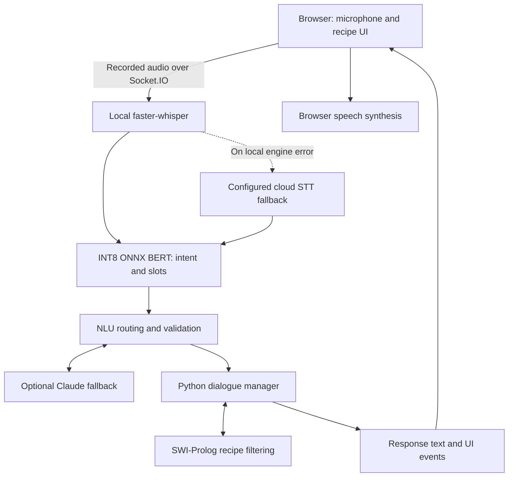

# CookingBroski

A voice-driven cooking assistant that helps users find recipes through conversational filters, exclusions, and follow-up questions. CookingBroski combines local speech recognition, a quantized BERT model, a Python dialogue manager, and Prolog-based recipe filtering, with cloud LLM fallbacks for open-ended requests.

This repository extends an earlier university conversational-agent project into a browser-based application deployed on Google Cloud Run. It is a portfolio prototype with automated evaluation and deployment workflows—not a multi-user production service.

## Try the demo

[Open the Cloud Run demo](https://social-agent-cloud-511906064574.us-central1.run.app/)

- Allow approximately 10–15 seconds for startup after inactivity; actual startup time can vary.
- Allow microphone access. Click to begin recording and click again to send your utterance.
- Use one active conversation at a time. Shared server-side dialogue state is a known limitation.
- Do not submit sensitive information. Configured fallback providers may receive audio or text, and tracing may record request content. See [limitations and data handling](docs/limitations.md).

### Example interaction

The following illustrates the intended workflow, not a captured benchmark transcript:

> User: Find an Italian dinner with tomatoes.  
> User: No mushrooms, and under 30 minutes.  
> User: Undo my last filter.  
> User: Show me another recipe.

The assistant updates recipe constraints across turns and presents matching recipes in the browser. Open-ended cooking questions can use the LLM fallback.

## Project evolution and contributions

The original course project supplied the starting point for the conversational cooking domain, recipe knowledge base, and dialogue design. The `main` branch contains the earlier project; the `cloud` branch contains the cloud-oriented extension described here.

The cloud extension adds or changes:

- **Dialogue runtime:** replaces the legacy agent/Java bridge with a Python state machine and direct `pyswip` integration, retaining SWI-Prolog reasoning.
- **NLU and data:** curates and expands intent/slot examples, adds dataset auditing, and exports the BERT model to dynamically quantized INT8 ONNX.
- **Browser experience:** introduces browser audio capture, recipe views, filter badges, video lookup, and speech-synthesis recovery behavior.
- **Delivery:** adds a containerized runtime, Cloud Run deployment, model-artifact retrieval, and CI quality checks.
- **Evaluation and operations:** adds dialogue regression tests, model-performance gates, structured telemetry, and optional Langfuse tracing.

The inherited system and these extensions should be considered separately when assessing the project's scope. Detailed licensing and original contributor attribution must be checked in the repository's original materials; this README does not assign a new license to inherited assets.

## Architecture at a glance



The browser records complete utterances rather than implementing continuous full-duplex audio. Local processing avoids a remote inference request for supported paths; configured fallbacks provide additional functionality, not guaranteed availability.

See [architecture and design decisions](docs/architecture.md) for the request lifecycle and state model.

## Engineering highlights

| Area | Implementation |
|---|---|
| Local NLU | Joint intent/slot BERT model exported to INT8 ONNX for CPU inference |
| Dialogue | Stateful Python routing, accumulated filters, rejection tracking, and undo support |
| Recipe reasoning | SWI-Prolog facts and deterministic constraint filtering |
| Speech | Local `faster-whisper`, optional remote STT fallbacks, browser TTS |
| Evaluation | Dataset audit, model thresholds, unit/dialogue regression tests, live smoke tests |
| Deployment | Docker, GitHub Actions, Cloud Build, Google Cloud Run |
| Operations | Per-stage timing, structured logs, optional Langfuse tracing |

## Evaluation status

The deployment workflow is described as enforcing minimum intent accuracy of 85% and slot F1 of 80%, alongside dataset checks and regression tests. These are configured acceptance thresholds, not measured results or guarantees of real-world accuracy.

Earlier project notes report approximately 6–8 ms for local BERT inference and intent accuracy around 93.7–94.9%, with slot F1 around 0.87–0.89. Those reports are not presented here as a single verified current benchmark: the supplied documentation contains conflicting dataset counts and train/test overlap statements.

For reproducible evaluation commands, the evidence needed to publish a benchmark, and the unresolved dataset reconciliation, see [evaluation and data quality](docs/evaluation.md).

## Local quickstart

Use the `cloud` branch for this version. From an existing checkout:

```bash
git switch cloud
python3.12 -m venv .venv
source .venv/bin/activate
python -m pip install --upgrade pip
python -m pip install -e "./social-interaction-cloud[webserver,nlu,dev]"
```

Install SWI-Prolog and FFmpeg, configure any required credentials, and obtain the model artifacts before starting the application. The model weights are not included in Git; a fresh checkout is not sufficient on its own.

```bash
python social-interaction-cloud/sic_framework/services/webserver/webserver_pca.py
```

Open `http://localhost:8080`. See [local development](docs/development.md) for system prerequisites, environment variables, model setup, and tests.

## Current limitations

- Shared in-process dialogue and Prolog state: not suitable for independent concurrent users without additional isolation.
- Scale-to-zero startup delay; the landing page can become available before inference models are ready.
- Browser-dependent microphone and speech-synthesis behavior.
- No continuous speech streaming or mid-response voice interruption.
- In-memory caches and metric counters reset when the process restarts.
- Cloud fallback capabilities depend on credentials, provider access, and network availability.

See [limitations, data handling, and next steps](docs/limitations.md).

## Documentation

- [Architecture and design decisions](docs/architecture.md)
- [Local development and model setup](docs/development.md)
- [Evaluation and data quality](docs/evaluation.md)
- [Deployment and operations](docs/deployment.md)
- [Limitations, data handling, and next steps](docs/limitations.md)

## Repository map

```text
.github/workflows/deploy.yml       # GitHub Actions checks and deployment
social-interaction-cloud/
  Dockerfile                      # Runtime image
  cloudbuild.yaml                 # GCP build/deployment workflow
  dialog_mngr/
    agent_python/                 # Dialogue manager, state, Prolog bridge
    *.pl                          # Recipe facts and reasoning rules
  sic_framework/services/
    nlu/                          # Inference, training/export, dataset audit
    webserver/                    # Flask/Socket.IO, STT, LLM, UI, telemetry
  tests/                          # Unit, dialogue, and live integration tests
```
