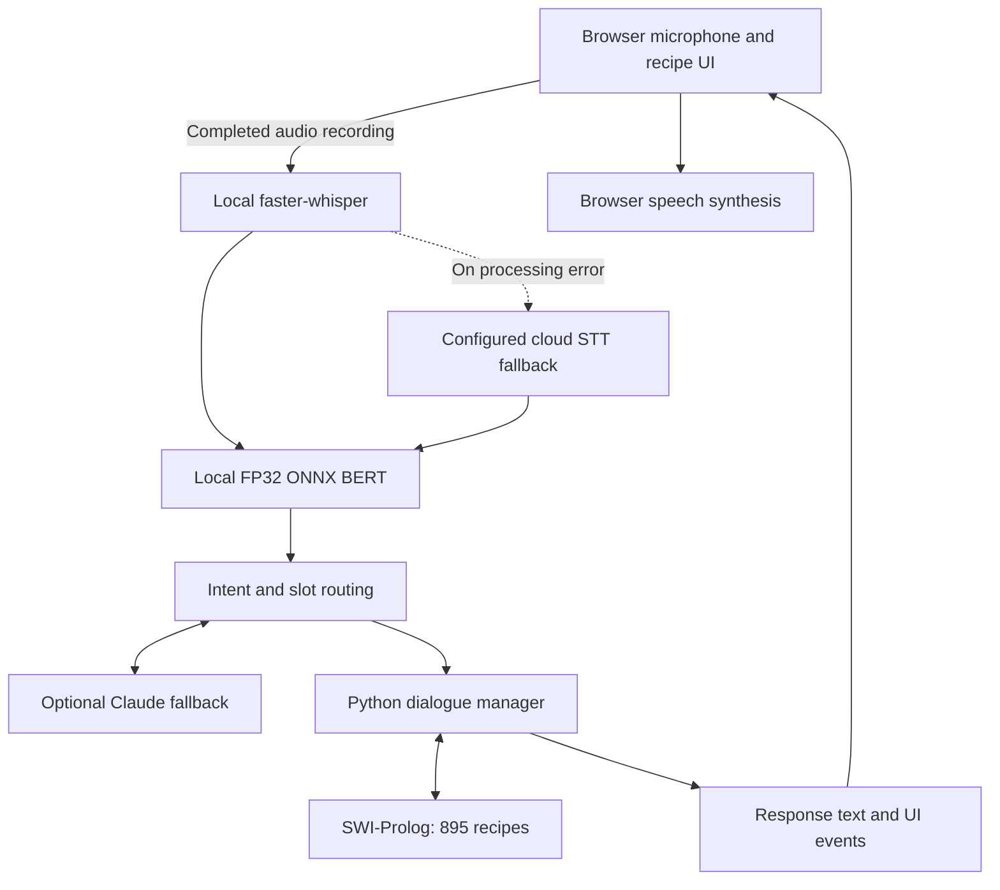

# CookingBroski

A voice-driven cooking assistant for finding recipes through conversational filters, exclusions, and follow-up questions. It combines local speech recognition, BERT intent and slot extraction, a Python dialogue manager, and Prolog recipe filtering, with Claude fallbacks for open-ended requests.

This portfolio project extends a university conversational-agent system into a browser-based application with automated evaluation, deployment workflows, and operational telemetry.

## Try it

| Demo | Hosting | What to expect |
|---|---|---|
| [Recommended: home-server demo](https://cookingbroski.mduchlinski.eu/) | Home server exposed through Cloudflare Tunnel | Instant, responsive interaction; availability depends on the connected users' instances |
| [Google Cloud demo](https://cloud-agent-conversational.web.app/) | Google Cloud Run, `us-central1` | Scale-to-zero hosting; startup and network delay can make interaction slower, Deployed for cloud platform practices but deployed with low budget plpanning |

Allow microphone access, click to start recording, and click again to send an utterance. Wait for model readiness before speaking.

Use one active conversation at a time: independent concurrent sessions are not yet isolated. Do not submit sensitive information; configured cloud fallbacks and tracing can process request content. See [limitations and data handling](docs/limitations.md).

### Example of usage

There is guidance instruction available on each webpage for user with inspiration of interaction with conversational agent. Here there are also some examples that illustrate supported interaction patterns, not a captured benchmark transcript:

> Find an Italian dinner with tomatoes.  
> No mushrooms.  
> Under 30 minutes.  
> Undo my last filter.  
> Show me another recipe.

The assistant maintains constraints across turns and displays matching recipes. Selected open-ended cooking questions use Claude when available.

## Current limitations

- Shared dialogue and mutable Prolog state are not isolated across independent users.
- Audio uses push-to-talk utterance upload, not continuous full-duplex streaming.
- Cloud Run can introduce startup delay; the home-server demo is not an availability guarantee.
- Browser speech behavior varies; in-memory caches and counters reset on restart.
- External fallback features depend on provider access and connectivity.
- Recipe filtering and generated advice are not an allergy or medical-suitability guarantee.

See [limitations](docs/limitations.md).

## Architecture



The current evaluated and reported deployed NLU backend is FP32 ONNX. INT8 export remains part of the project's development history but is not the basis of the results below. See [architecture](docs/architecture.md).

## Repository layout

```text
conversational_agents/
├── .github/
│   └── workflows/
│       └── deploy.yml              
├── cloud-gatekeeper/               # Edge gatekeeper hosted on Firebase Hosting CDN
│   ├── firebase.json               # Edge rewrite proxy configuration to Cloud Run
│   └── public/
│       └── index.html              # Instant cold-start progress UI & warm-session bypass
├── docs/
│   ├── documentation.md
│   ├── architecture.md
│   ├── development.md
│   ├── evaluation.md
│   ├── deployment.md
│   ├── limitations.md
│   ├── release_manifest.md
│   ├── SHA256SUMS
│   └── system_verification_report.md # Verifiable record of model eval, audit gate, and test execution
├── social-interaction-cloud/       # Core application source and framework
│   ├── Dockerfile                  
│   ├── cloudbuild.yaml             
│   ├── pyproject.toml              # Build system, package dependencies, and optional extras
│   ├── requirements.txt            # Locked runtime dependencies
│   ├── dialog_mngr/                # Dialogue management & symbolic recipe knowledge base
│   │   ├── agent_python/           # Python dialogue orchestrator, state tracker, and pyswip bridge
│   │   │   ├── dialog_manager.py   # Turn-by-turn conversational policy and intent dispatcher
│   │   │   ├── state.py            # Turn history, accumulated positive/negative filters, undo stack
│   │   │   └── prolog_interface.py # In-process SWI-Prolog query engine via pyswip
│   │   ├── recipe_database.pl      # Knowledge base with 895 structured Prolog recipe facts
│   │   ├── ingredient_hierarchies.pl # Taxonomy of ingredients, cuisines, and dietary restrictions
│   │   └── dialog.pl, dialogflow.pl, responses.pl # Deterministic dialogue rules & template responses
│   ├── sic_framework/services/
│   │   ├── nlu/                    # Natural Language Understanding pipeline
│   │   │   ├── fast_bert_nlu.py    # ONNX inference engine (FP32 DistilBERT intent & slot tagging)
│   │   │   ├── train_and_export.py # PyTorch training, evaluation gate, and ONNX export utility
│   │   │   └── utils/
│   │   │       ├── dataset_audit.py # CI/CD gate for train-test leakage and label conflicts
│   │   │       ├── tokenization.py  # Fast WordPiece tokenizer wrapper (Rust tokenizers)
│   │   │       ├── dataset.py       # PyTorch Dataset and joint Intent/Slot DistilBERT model
│   │   │       ├── checkpoints/     # Local model weights (bert_nlu.onnx) & experiment history
│   │   │       └── data/            # Ontology, vocabulary (vocab.txt), train/test/exclusion splits
│   │   └── webserver/              # Web application and external service integrations
│   │       ├── webserver_pca.py    # Flask & Socket.IO server, audio reception, telemetry endpoints
│   │       ├── llm_nlu_service.py  # Claude Haiku fallback, prompt caching, Pydantic NLU extraction
│   │       ├── stt_service.py      # Faster-Whisper local STT with ElevenLabs/OpenAI fallbacks
│   │       ├── tts_service.py      # Google Cloud / browser speech synthesis coordination
│   │       ├── telemetry.py        # Stage-by-stage latency logging and Langfuse tracing hooks
│   │       ├── templates/          # Jinja2 HTML views (welcome, recipe grid, confirmation)
│   │       └── static/             # Client-side JS (audio recording, WebM upload, TTS callbacks), CSS
│   └── tests/                      # full test suite (138 tests)
│       ├── evals/
│       │   └── test_golden_dialogues.py # 110 single-turn golden utterance regression evaluations
│       ├── test_dialog_behaviors.py     # Dialogue state, undo, filtering, and rejection tests
│       ├── test_e2e_cloud_run.py        # Live HTTP, WebSocket, and readiness smoke tests
│       ├── test_google_services.py      # STT / TTS service unit tests
│       ├── test_openai_services.py      # FastBERTNLU and subword alignment unit tests
│       └── test_webserver.py            # Webserver routing, health probes, and cache tests
├── LICENSE                         # MIT License for cloud extensions with third-party notices
└── README.md
```
## API and protocol overview

CookingBroski exposes HTTP endpoints for health probes, telemetry, and UI views, alongside a WebSocket (Socket.IO) protocol for real-time voice and dialogue orchestration.

### HTTP REST and probe endpoints

| Method | Path | Format | Description |
|---|---|---|---|
| `GET` | `/` | HTML | Application landing view (`start.html`); resets session state |
| `GET` | `/<page>.html` | HTML | Dynamic Jinja2 view rendering (`welcome.html`, `recipe_overview.html`, `recipe_confirmation.html`) |
| `GET` | `/api/health` | JSON | Liveness probe: responds immediately with `{status: "ok", models_ready: bool}` |
| `GET` | `/api/ready` | JSON | Readiness probe: returns `200` once Faster-Whisper and FastBERTNLU finish warmup (`503` during warmup) |
| `GET` | `/api/metrics` | JSON | Operational telemetry: component latency histograms (STT, NLU, Prolog), cache hit counters, and errors |
| `GET` | `/api/youtube/search` | JSON | Recipe video lookup via YouTube Data API with a 512-entry LRU in-memory cache |

### Real-time Socket.IO protocol

| Direction | Event | Payload | Description |
|---|---|---|---|
| Client → Server | `connect` | — | Establishes WebSocket transport with a disconnect grace timer to preserve active state |
| Client → Server | `client_start` | `{}` | Signals UI readiness; triggers agent greeting and initial overview |
| Client → Server | `audio_stream` | `Blob` (WebM) | Transmits recorded utterance for STT transcription, NLU intent/slot tagging, and Prolog query |
| Client → Server | `buttonClick` | `{button: str, ...}` | Forwards button and filter click interactions directly to the dialogue policy |
| Server → Client | `speech` | `str` | Full agent response string to be spoken by browser `window.speechSynthesis` |
| Server → Client | `speech_chunk` | `{text, is_first, is_final}` | Streamed speech clause chunks from Claude Haiku for lower perceived speech latency |
| Server → Client | `load_page` | `{page: str}` | Signals browser to navigate between views while preserving WebSocket connection |


## Evaluation snapshot

The following results are transcribed from the maintainer's verification summary supplied on 24 October 2026. They describe a specific tested version, not an uptime or general-quality guarantee.

| Check | Reported result |
|---|---|
| Verified source | `79beb1bc5f04474120234cadd53c34e0a1f22d35`, branch `cloud` |
| Runtime | Python 3.12.7 |
| Dataset | 9,008 examples: 7,037 training / 1,971 evaluation |
| Normalized train/test text overlap | 0 detected |
| Cross-intent near-duplicate conflicts | 0 detected under the audit's configured checks |
| Local NLU backend | FP32 ONNX, `bert_nlu.onnx` |
| Intent accuracy | 94.98% on 1,971 evaluation examples |
| Slot-type F1 | 88.48%, support-weighted WordPiece-token F1; BIO prefixes merged, `O` excluded from averaged classes |
| Automated suite | 138 passed in the reported run, including 110 single-turn golden cases |

These model metrics evaluate local BERT, not the complete speech/heuristic/LLM pipeline. Full methodology, artifact identity, and test breakdown: [evaluation](docs/evaluation.md) and [system verification report](docs/system_verification_report.md).


## Local quickstart

Install Python 3.12, SWI-Prolog, and FFmpeg first. Clone the `cloud` branch from GitHub:

```bash
git clone --branch cloud https://github.com/ducchuu/conversational_agents.git cookingbroski
cd cookingbroski
python3.12 -m venv .venv
source .venv/bin/activate
python -m pip install --upgrade pip
python -m pip install -e "./social-interaction-cloud[webserver,nlu,dev]"
```

Obtain the compatible pretrained FP32 model, configure the optional services you want to use, then start the application:

```bash
python social-interaction-cloud/sic_framework/services/webserver/webserver_pca.py
```

Open `http://localhost:8080` and wait for readiness. Full instructions: [development guide](docs/development.md).

### Pretrained model downloads

Pretrained model weights are distributed via GitHub Releases (`v1.0.0`). Download the compatible model asset directly into the expected checkpoints directory:

```bash
mkdir -p social-interaction-cloud/sic_framework/services/nlu/utils/checkpoints

gh release download v1.0.0 \
  --repo ducchuu/conversational_agents \
  --pattern bert_nlu.onnx \
  --dir social-interaction-cloud/sic_framework/services/nlu/utils/checkpoints
```

The expected runtime location is:

```text
social-interaction-cloud/sic_framework/services/nlu/utils/checkpoints/bert_nlu.onnx
```

Verify its SHA-256 checksum (`7e77e9ef55c57af6cbf888f6ce26ed04e4c57e3f9edcc1b0dc6d57f94c11dee5`). See [release and model download instructions](docs/development.md#pretrained-model-download) for full details and offline verification scripts.


## What changed from the original project?

The earlier `main` branch contains the university project. The `cloud` branch contains the extension described here.

The original project supplied the Social Interaction Cloud framework integration, MARBEL-based dialogue system, initial NLU data, and Prolog recipe knowledge base. The independent extension adds or changes:

- Python dialogue routing and direct `pyswip` integration in place of the legacy agent/Java bridge.
- Accumulated inclusion/exclusion filters, rejected-recipe tracking, and undo behavior.
- Curated NLU data, a shared WordPiece tokenizer, ONNX inference, and dataset-quality gates.
- Browser microphone capture, recipe views, video lookup, and speech-synthesis recovery.
- Local speech recognition, Claude fallbacks, structured telemetry, and optional LLM tracing.
- Containerized hosting, CI/CD, regression tests, and live deployment checks.

See [attribution and licensing](docs/documentation.md#attribution-and-licensing) for original contributors and unresolved licensing boundaries.


## Documentation

Start with the [documentation index](docs/documentation.md), or go directly to:

- [Architecture](docs/architecture.md)
- [Development and model setup](docs/development.md)
- [Evaluation](docs/evaluation.md)
- [Deployment and operations](docs/deployment.md)
- [Limitations and data handling](docs/limitations.md)

